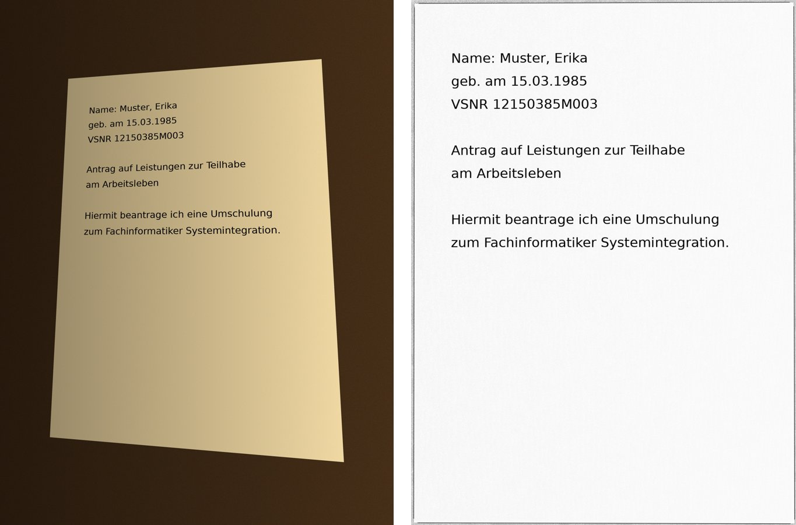

# akten-interlock

Poka-Yoke für die E-Akte. Eine schlanke Open-Source-Schicht vor bestehenden
Fachverfahren, die die Übergänge absichert, an denen Fehler sonst unbemerkt durchlaufen:

| Übergang | Sperre | Was sie verhindert |
| --- | --- | --- |
| Eingang → Akte | Identitätsprüfung (VSNR mit Prüfziffer, Name, Geburtsdatum) + Policy | Dokument einer fremden Person landet in der Akte |
| Akte → Gericht/Dritte | Endkontrolle aller Dokumente, Vollständigkeits-Manifest, Vier-Augen-Freigabe | Fremddaten oder lückenhafte Akte verlassen das Haus |
| Zeit | Fristenwächter §§ 14, 18 SGB IX mit Ampel und Eskalation | Antrag bleibt liegen, begründete Mitteilung fehlt |
| Eingang (Handyfoto) | Foto-Aufbereitung: Blatt finden, entzerren, Schatten und Farbstich entfernen, Qualität messen | „Konnte wegen schräger, farbiger Fotos nicht in die PDF“ |

Dazu ein **Not-Halt**: Ein gemeldeter Datenschutzvorfall stoppt jeden Versand nach außen,
bis eine benannte Person (z. B. die Datenschutzbeauftragte) zurücksetzt.

Der Prüfkern ist [agent-interlock](https://github.com/McMDMC/agent-interlock):
deterministische TOML-Policy, fail-closed, Lockout nach wiederholten Verstößen,
Not-Halt, hash-verkettetes Audit-Protokoll. Keine KI entscheidet.

## Schnellstart

```bash
pip install -e ".[dev]"          # Python 3.11+
akten-interlock demo             # Ausgangsfall mit synthetischen Daten
pytest -q
```

Mit PDF/A-Konvertierung und Foto-Aufbereitung (OCRmyPDF, Tesseract, Ghostscript, OpenCV):

```bash
pip install -e ".[dev,pdf,foto]"   # plus Systempakete: ocrmypdf tesseract-ocr-deu ghostscript
```

Oder im Container:

```bash
docker build -t akten-interlock .
docker run --rm akten-interlock demo
docker run --rm -v "$PWD/eingang:/home/akte/eingang" akten-interlock normalisiere eingang/scan.tif --ziel eingang/out
```

## Kommandos

```text
akten-interlock demo [--audit audit.jsonl]
akten-interlock fristen --eingang 2025-03-03 --heute 2025-06-10 [--mitteilung-am ...] [--gutachten --gutachten-am ...]
akten-interlock vsnr "65 170839 J 003"
akten-interlock normalisiere <datei> [--ziel ausgang] [--ohne-foto]
akten-interlock audit-pruefen audit.jsonl
akten-interlock mcp --akten beispiel/akten.json [--rolle posteingang] [--audit audit.jsonl] [--transport streamable-http]
```

## Handyfotos: aufbereiten statt aussortieren

Ein schräg und farbstichig fotografiertes Blatt ist eine ganz normale Bilddatei. Es lässt sich
immer in ein PDF einbetten; schlechte Qualität beeinträchtigt nur die Texterkennung.
`akten-interlock normalisiere` macht daraus eine lesbare Fassung und behält das Original:

1. **Laden:** JPEG, PNG, TIFF, WebP und HEIC/HEIF (Standardformat vieler Smartphones),
   EXIF-Drehung wird angewendet.
2. **Blatt finden und entzerren:** größtes Viereck über Kanten und helle Fläche, dann
   perspektivische Transformation (OpenCV).
3. **Schatten und Farbstich entfernen:** Papierhelligkeit schätzen und herausrechnen,
   Standard Graustufen, optional Farbe.
4. **Qualität messen:** effektive Auflösung bezogen auf DIN A4 (Minimum 150 dpi) und Schärfe.
   Bei Mängeln wird eine Rückfrage an den Absender empfohlen, die Datei geht trotzdem nicht verloren.
5. **PDF/A-2b mit Texterkennung** (OCRmyPDF mit `--deskew --rotate-pages`).
6. **Original unverändert** unter `<ziel>/original/`, SHA-256 im Protokoll.



```text
$ akten-interlock normalisiere antrag.jpg --ziel ausgang
pdfa: ausgang/antrag.pdfa.pdf (1 S.) sha256=…
Protokoll: Original gesichert …; Blatt erkannt, Perspektive entzerrt; Schatten und Farbstich
entfernt (graustufen); Lesefassung 2248x3073 px, ca. 271 dpi; Bild verlustfrei nach PDF
(img2pdf); PDF/A-2 erzeugt (ocrmypdf)
Original: ausgang/original/antrag.jpg
```

Getestet wird mit künstlich verzerrten Testbildern (`tests/testbild.py`): Ecken auf unter 1 %
genau gefunden, Seitenverhältnis ungefähr DIN A4, Papier nach Aufbereitung gleichmäßig weiß,
Farbstich weg, Unschärfe und zu geringe Auflösung erkannt, HEIC und EXIF-Drehung, Texterkennung
liest Name und Geburtsdatum, Ergebnis ist PDF/A-2.

## Die Policy

`src/akten_interlock/policies/akte.toml` ist die einzige Stelle, an der festgelegt wird,
was erlaubt ist. Auszug:

```toml
[tools.dokument_ablegen]
class = "write"
params.identitaet = { enum = ["match"] }       # alles andere wird abgewiesen

[tools.akte_exportieren]
class = "actuate"                               # verlässt das Haus, vom Not-Halt erfasst
require_approval = true                         # Vier-Augen-Freigabe
agents = ["export"]
params.fremd_treffer = { type = "int", min = 0, max = 0 }
params.quarantaene_offen = { type = "int", min = 0, max = 0 }
params.manifest_vollstaendig = { type = "bool", enum = [true] }
```

Für die Einführung `mode = "observe"` setzen: Entscheidungen werden protokolliert,
aber nicht durchgesetzt. Lockout und Not-Halt greifen trotzdem.

## KI: optional, austauschbar, nie entscheidend

`extraktion.ModelRouter` nimmt beliebige Modelle als Funktion `text -> dict` entgegen
(lokal oder Cloud) und fällt bei Fehlern auf die nächste Stufe, zuletzt auf reine
Regel-Extraktion zurück. Was die KI vorschlägt, läuft immer durch Identitätsprüfung und
Policy. Kein Anbieter ist fest verdrahtet.

## Als Werkzeug für KI-Agenten (MCP)

Agent-Orchestratoren binden Werkzeuge über das Model Context Protocol an. Der Agentic
Orchestrator der Verwaltungs-KI F13 lädt Werkzeuge zum Beispiel je Mandant über MCP-Endpunkte
und prüft jeden Aufruf vorher mit einer OPA-Regel. Akten-Interlock lässt sich dort als
Werkzeugserver andocken, ohne F13 zu verändern:

```bash
pip install -e ".[mcp]"
akten-interlock mcp --akten beispiel/akten.json --transport streamable-http --audit audit.jsonl
# Endpunkt: http://127.0.0.1:8765/mcp
```

| Werkzeug | Wirkung | Prüfkern |
|---|---|---|
| `dokument_ablegen` | legt nur bei passender Identität ab, sonst Quarantäne | ja |
| `akte_export_vorpruefen` | zeigt, ob ein Versand die Sperren passieren würde, versendet nichts | ja (`akte_lesen`) |
| `quarantaene_auflisten` | offene Fälle einer Akte | ja (`akte_lesen`) |
| `vsnr_pruefen` | Format und Prüfziffer | nein, rechnet nur |
| `fristen_berechnen` | Fristen §§ 14, 18 SGB IX mit Ampel | nein, rechnet nur |

Damit das Modell die Sperren nicht umgehen kann:

* Die Rolle wird beim Start gesetzt (`--rolle`). Kein Werkzeug hat einen Parameter dafür,
  und `export` ist als Rolle nicht zulässig.
* Es gibt kein Versandwerkzeug. Versand bleibt ein Schritt für Menschen mit Vier-Augen-Freigabe.
* Der Server hat keinen Freigeber und startet nicht mit einem. Was die Policy zur Freigabe
  vorlegt, geht in die Quarantäne und wird von einer benannten Person geklärt.
* Antworten und Audit enthalten keine Personendaten der Akte. Das Modell erfährt, dass ein
  Merkmal abweicht, aber nicht, wie es in der Akte lautet. Ein Test prüft das.
* Die Formate im Werkzeug-Schema stammen aus der Policy. Ein Test schlägt fehl, wenn sie
  auseinanderlaufen.

Zwei Prüfungen, zwei Zuständigkeiten: F13s OPA-Regel entscheidet, ob ein Agent ein Werkzeug
überhaupt aufrufen darf. Akten-Interlock entscheidet fachlich, ob dieses Dokument in diese
Akte darf, und protokolliert das hash-verkettet. Damit gibt es auch für die Aufrufe hinter dem
Gateway eine Audit-Spur.

Der Server prüft noch keine Tokens. HTTP lauscht deshalb nur auf Loopback; eine andere
Adresse verweigert der Start ohne `--ohne-auth-im-netz`. Für einen echten Betrieb gehört er
hinter ein Gateway mit Authentifizierung. Die Feldnamen für die Anbindung in F13
(`configs/tenants/<id>/tenant.yml`) stehen in F13s `docs/entwicklung/konfiguration.md`; sie
sind hier nicht nachgebildet.

## Datenschutz im Design

* Der Prüfkern und das Audit-Protokoll sehen nur Metadaten: IDs, Prüfergebnis, Hash,
  Seitenzahl. Keine Inhalte, keine Gesundheitsdaten.
* Das Manifest (Inhaltsverzeichnis mit Blattzahlen und SHA-256 je Dokument) entspricht
  der Idee des Begleitdatensatzes nach § 2 Abs. 4 BehAktÜbV.
* Nicht konvertierbare Dateien werden im Original beigefügt und markiert
  (§ 3 Abs. 3 BehAktÜbV), nie still weggelassen.

## Grenzen

Prototyp. Die Foto-Schwellen (150 dpi, Schärfewert 80) sind an Testbildern kalibriert, nicht
an echten Eingängen; vor einem Betrieb an anonymisierten Echtdaten nachjustieren. Gewölbte
Seiten (Buchfalz) werden nicht entzerrt. Keine Anbindung an ein echtes Fachverfahren, keine
Benutzerverwaltung, Feiertage nur als übergebene Liste. Der MCP-Server hält Akten nur im
Speicher (geladen aus JSON) und prüft keine Tokens. Die Fristberechnung zeigt Fristen und eskaliert,
sie entscheidet nicht, ob eine Genehmigungsfiktion eingetreten ist. Alle Daten in
Tests und Demo sind erfunden.

## Lizenz

Apache-2.0
